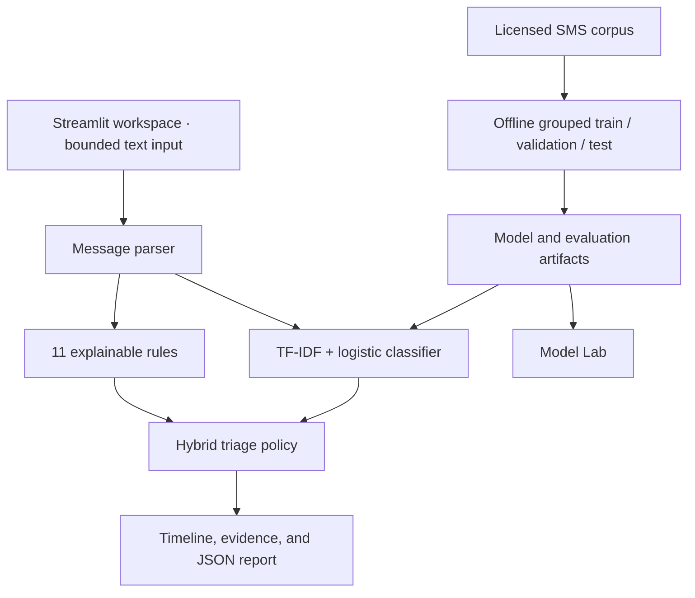

# ScamSignal AI

**See where the conversation turns.** An interactive investigation workspace that combines a trained text classifier with an explainable scam-rule engine.

[**Try the live app →**](https://scamsignal-cudqj7eqefjdkp8j2hvkyn.streamlit.app/) · [Model card](docs/MODEL_CARD.md) · [Architecture](docs/ARCHITECTURE.md) · [30-second demo](docs/DEMO.md)


> **Honest scope:** the ML model detects spam-like language, trained on labelled English SMS. The rules identify specific scam behaviours. Neither engine proves fraud or authenticates a sender. This is an engineered portfolio demonstration, not a validated production fraud service.

## Try it in one minute

1. Open the app; the **Fake job offer** is ready to inspect.
2. Click **Start**, then **First signal**. Message 3 introduces an equipment fee.
3. Reveal the later payment and secrecy requests. Inspect the highlighted phrases and rule explanations.
4. Open **Model evidence** to see learned word contributions. Notice that the model can disagree with the rules.
5. Try **Legitimate security advice**, **Friends splitting dinner**, and **Subtle impersonation** to explore false positives and misses.
6. Open **Model lab** for the actual confusion matrix and a validation-only threshold explorer.

## What is built

- **Investigation dashboard:** responsive dark UI, conversation replay, first-signal navigation, cumulative rule severity, and per-message model scores.
- **Real machine learning:** TF-IDF word/bigram features and logistic regression, trained offline; bundled JSON artifact; no API key or runtime training.
- **Explainability:** exact rule offsets and highlighted phrases; learned, signed term contributions to model log-odds; actionable verification guidance.
- **Separate evidence:** the rule index, ML spam score, and hybrid decision policy retain their own meanings. There is no invented blended probability.
- **11 fictional scenarios:** scams, ordinary exchanges, safety advice, ambiguous payment requests, and a subtle impersonation that can evade both engines.
- **Evaluation workspace:** held-out metrics, confusion matrix, class imbalance baseline, comparison of all engines, uncertainty interval, and limitations.
- **Privacy-conscious design:** no external inference calls or message database; per-session state; clear control; text-free report export by default.
- **Engineering checks:** unit and Streamlit application tests, reproducible split manifests and predictions, pinned direct dependencies, and GitHub Actions.

## Measured results

Positive class: **spam**. Dataset: [UCI SMS Spam Collection](https://archive.ics.uci.edu/dataset/228/sms+spam+collection), attributed to Almeida & Hidalgo, CC BY 4.0.

5,574 downloaded records → 5,159 unique messages after case/whitespace duplicate removal. Normalised templates are kept within one split. **3,095 train / 1,032 validation / 1,032 test**. The vocabulary and IDF weights see training data only. The 0.49 alert threshold is chosen on validation data only.

| System | Precision | Recall | F1 | Accuracy |
|---|---:|---:|---:|---:|
| Trained classifier | 94.53% | 94.53% | 94.53% | 98.64% |
| Rules only (severity ≥55) | 0.00%* | 0.00% | 0.00% | 87.60% |
| Hybrid (model flag OR rules ≥55) | 94.53% | 94.53% | 94.53% | 98.64% |
| Always predict ham | 0.00%* | 0.00% | 0.00% | 87.60% |

\* No positive predictions; undefined precision is reported as 0. No test SMS reaches the rules' high-concern threshold. **This benchmark does not demonstrate a hybrid improvement.** It tests older SMS spam, not modern conversation scams.

| Actual \ predicted | Ham | Spam |
|---|---:|---:|
| Ham | 897 | 7 |
| Spam | 7 | 121 |

There are **7 false alarms and 7 missed spam messages**. Model F1 95% group-bootstrap interval: **91.63%–97.27%** (500 template-group resamples). One test message has no known vocabulary; the deployed app abstains on such inputs, producing no model alert. Metrics include that message as unflagged.

Full results: [evaluation.json](artifacts/evaluation.json) · [test predictions](artifacts/test_predictions.csv) · [split manifest](artifacts/split_manifest.csv). Scores are **not calibrated fraud probabilities**. Demo scenarios are not training or benchmark data.

## Run locally

Python **3.11 or 3.12** is recommended.

```bash
git clone https://github.com/nebilali1/scamsignal.git
cd scamsignal
python -m venv .venv
source .venv/bin/activate
# Windows PowerShell: .venv\Scripts\Activate.ps1
python -m pip install -r requirements.txt
python -m streamlit run app.py
```

The trained artifact is committed, so first launch needs **no dataset download, training, model-service account, or API key**. Open the local URL printed by Streamlit.

```bash
python -m pip install -r requirements-dev.txt
python -m pytest -q
python -m ruff check --select E9,F63,F7,F82,F401 .
```

Tests exercise rule negation, exact offsets, sender parsing, input limits, HTML escaping, default export privacy, cumulative scoring, replay causality, model export parity, split leakage, metric consistency, all demo scenarios, and session persistence across navigation.

## Reproduce training

The unmodified source corpus and its original readme are included in `data/raw/`, with attribution in [data/README.md](data/README.md). Training verifies its SHA-256 before using it.

```bash
python -m scripts.train_model
python -m pytest -q
```

First install `python -m pip install -r requirements-training.txt` if you only installed the app dependencies. This regenerates `artifacts/model.json.gz`, `evaluation.json`, `split_manifest.csv`, and `test_predictions.csv`. No network is required. The model hyperparameters are fixed; the declared validation threshold-selection rule is reproducible. Floating-point output or environment metadata can differ across library/Python versions. The tests check inference and metrics within numeric tolerances.

## Architecture



`app.py` handles UI and per-session state. `detector.py` preserves the original `analyze()` API, extending it with stable IDs and evidence spans. `timeline.py` preserves the original splitting API and adds sender parsing, prefix-safe replay, and independent ML results. `ml.py` reproduces trained TF-IDF and logistic inference with Python’s standard library, loading numeric JSON without pickle or scientific-library imports. `presentation.py` escapes untrusted text and builds reports. `scripts/train_model.py` owns the reproducible experiment.

See [architecture and threat model](docs/ARCHITECTURE.md) and [initial audit](docs/INITIAL_AUDIT.md).

## Deployment

The existing Streamlit entrypoint remains **`app.py` on `main`**. Community Cloud normally rebuilds after the branch updates. If needed, open the app's management menu and reboot it. If the environment is older than Python 3.11, redeploy using Python 3.12 and the same repository/entrypoint. No secrets are required. See [deployment checks](docs/DEPLOYMENT.md).

Community Cloud can sleep after inactivity. Open the app and complete one demo before presenting it; keep the page available for your recruiter conversation. Local execution is the fallback if conference connectivity is unreliable.

## Limitations and next steps

The corpus predates modern scam tactics and contains spam labels, not verified fraud outcomes. Template grouping cannot eliminate semantic duplicates. English-only training does not establish multilingual accuracy. Regex rules have limited context and can flag legitimate urgency, payments, and quoted scam language. The maximum per-message ML score can rise in longer conversations; it is not a conversation probability, and that aggregation has not been independently benchmarked.

Production work would require contemporary, independently labelled fraud conversations, stronger near-duplicate controls, external validation, calibration, robustness testing, and operational monitoring with an explicit privacy policy. Authentication, organisation workflows, abuse controls, attachment analysis, and domain reputation are intentionally outside this demonstration.

**Built by [Nebil Ali](https://github.com/nebilali1)** · Computer Science, Connecticut College.

Code: [MIT](LICENSE). Dataset: [CC BY 4.0](https://creativecommons.org/licenses/by/4.0/) with separate attribution. Model artifact is derived from that dataset; retain the attribution when redistributing it.
